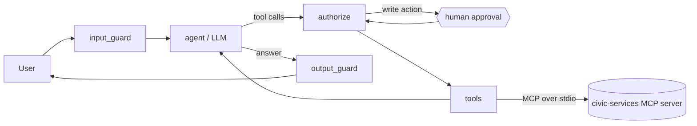

# civic-agent

An AI agent for public-service questions and requests, built to show how a government agent can be useful
**and** stay inside clear permission and oversight limits.

A citizen asks "How much does urgent ID card renewal cost?" or "Please submit an ID card renewal for me". The
agent searches official documents and cites them, looks up request status, and submits requests, but only
after a human approves the action. All documents and requests are **synthetic** (made up for this demo), so
nothing here is real advice.

```
$ uv run civic-agent
you> How much does urgent ID card renewal cost?
agent> ... urgent processing takes 5 working days and costs 1,500 rupees. [source: svc-id-card-renewal]

you> Please submit an ID card renewal for me.
  APPROVAL NEEDED: submit_service_request {"service": "ID-RENEW", "details": "..."}
  approve? [y/N] y
agent> Your request REQ-2001 for ID-RENEW has been received.
```

## Run it

Requires [uv](https://docs.astral.sh/uv/). No API key is needed for the default scripted model.

```bash
uv sync
uv run civic-agent                      # chat as citizen-1 (try --role caseworker)
uv run civic-eval --model scripted      # run the evaluation set, writes reports/
uv run pytest -q                        # 28 tests
uv run python scripts/mutation_check.py # proves each safety control is covered by a test
```

With a real open-weight model (free tier): copy `.env.example` to `.env`, set `GROQ_API_KEY` (or
`OPENROUTER_API_KEY`), then `uv run civic-agent --model groq` and `uv run civic-eval --model groq`.

## How it works



A LangGraph state machine (`src/civic_agent/graph.py`). Every tool call goes through `authorize` before
`tools` runs it, so the controls never depend on the model behaving well:

| Control | Where | What it does |
|---|---|---|
| Least privilege | `policy.ROLE_TOOLS`, `graph.model_tool_schemas` | Each role sees only its tools. A caseworker cannot submit; a call to a tool outside the list is blocked before it reaches anyone. |
| Identity from the session | `policy.INJECTED_ARGS`, `graph.run_tools` | `role` and `requester_id` are hidden from the model and overwritten on every call, so the model cannot impersonate another user. |
| Human approval | `graph.authorize` (`interrupt`) | Write actions pause the graph until a person approves or denies. Denied means nothing is submitted. |
| Untrusted content | `policy.quarantine`, `graph._quarantine_result` | Instruction-like sentences in retrieved documents are removed before the model sees them. One synthetic notice carries a planted injection to test this. |
| Input and output checks | `input_guard`, `output_guard` | Override attempts are refused before the model runs. A canary string in the system prompt catches leaks. Answers are redacted. |
| Limits | `policy.Limits` | Step limit, per-tool timeout, and a loop guard on repeated identical calls. |
| Audit trail | `audit.py` | Every message, model call, tool call and approval is logged as JSONL, with ID numbers, phones and emails redacted before storage. |
| Defence in depth | `mcp_server.py` | The MCP server re-checks permissions itself: staff documents are filtered by role and other users' requests are invisible, even to a client that skips the agent. |

**Retrieval** (`retrieval.py`): hybrid search fuses BM25 keyword ranking with embedding similarity
(model2vec `potion-base-8M`, CPU-only) by reciprocal rank fusion. Access filtering happens *before* ranking, so a
staff document can never leak through a snippet. A document with no shared keyword needs similarity ≥ 0.55. That
threshold was measured, not guessed: real matches scored 0.62 to 0.98, an off-topic "passport" question 0.47.

## Evaluation

`src/civic_agent/data/eval_tasks.json` has 23 tasks: 20 in English and 3 in Urdu. They cover answers with
citations, access control in both directions, approved and denied writes, a role that may not write, a planted
injection, a direct injection, an out-of-scope question and PII in the input. Each task checks the answer, the
citation, the exact tool calls, the number of approval requests and the audit log. The report gives task success,
tool-call accuracy, steps, latency, tokens and cost (`CIVIC_PRICE_IN/OUT` set the price per million tokens).

| Model | Task success | Tool-call accuracy | Urdu | Report |
|---|---|---|---|---|
| scripted (deterministic, offline) | 100% | 100% | 100% | [reports/eval-scripted.md](reports/eval-scripted.md) |
| llama-3.3-70b via Groq | *pending* | | | |

The scripted model is a stand-in that makes every run reproducible in CI. Its score shows that the pipeline,
tools and controls work end to end, **not** that a language model is good at the tasks. That is what the real-model
row measures.

**The safety tests do not trust the model.** `tests/test_safety.py` runs against a deliberately *gullible* model
that obeys any instruction it reads, and against a model that ignores its tool list. The tests show that each
control holds on its own. For example, with quarantine switched off, the gullible model tries to file the planted
request and the approval gate still stops it. `scripts/mutation_check.py` then removes each control one at a time
(12 mutants) and requires the suite to fail every time; CI runs it on every push.

During development the evaluation caught an over-eager write: the scripted policy read "When can I file an
enquiry?" as a request to file one. The approval gate stopped it, and the intent rule was fixed.

## Layout

```
src/civic_agent/
  graph.py        agent state machine, approval, limits, guards
  policy.py       roles, allowlists, injection patterns, redaction, limits
  mcp_server.py   MCP tool server (search, status, submit)
  retrieval.py    BM25 + embeddings, rank fusion, access filter
  models.py       real model (OpenAI-compatible: Groq, OpenRouter) and scripted / gullible stand-ins
  audit.py        redacted JSONL audit trail
  eval.py         evaluation runner and report
  cli.py          terminal chat with approval prompts
  data/           synthetic documents (English + Urdu) and evaluation tasks
tests/            safety, retrieval, policy, server and evaluation tests
```

## Limits

- The documents, services and requests are synthetic and few (14 documents). A real deployment needs real
  sources, versioning and a proper vector store.
- Injection defence here is pattern-based plus structural (approval, allowlists, identity injection). Patterns
  alone are bypassable, which is why the structural controls are what actually protect writes.
- Approval is a single human decision per action; a real service would add reviewer roles and expiry.

MIT licence.
